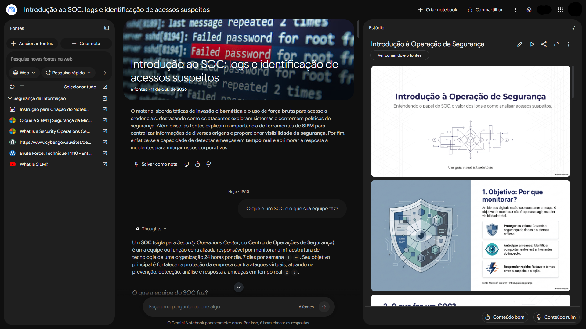

# Introdução ao SOC: logs e identificação de acessos suspeitos

## 📌 Sobre o projeto

Projeto do desafio da **Digital Innovation One (DIO)** para construir um caderno temático com IA, fontes confiáveis e respostas com citações.

O estudo explora como uma equipe de segurança usa registros de atividades para reconhecer acessos que merecem atenção, com linguagem introdutória e exemplos fictícios.

*Visão geral do caderno temático desenvolvido no Gemini Notebook.*

**Objetivo:** compreender o papel de um SOC, aprender a observar logs de acesso e organizar uma análise simples, distinguindo suspeitas de conclusões.




## 📖 Curadoria de fontes

Foram selecionadas cinco fontes em texto, PDF e vídeo, pela autoria e relevância para o tema. O notebook também contém uma instrução de orientação, que não é uma fonte técnica.

| Fonte | Por que foi escolhida |
|---|---|
| [Microsoft: o que é um SOC?](https://www.microsoft.com/en-us/security/business/security-101/what-is-a-security-operations-center-soc) | Introdução ao SOC pelo próprio fornecedor. |
| [ASD/ACSC e parceiros: boas práticas de logs, PDF de 2024](https://www.cyber.gov.au/sites/default/files/2024-08/best-practices-for-event-logging-and-threat-detection.pdf) | Guia institucional sobre logs e detecção. |
| [MITRE ATT&CK: Brute Force](https://attack.mitre.org/techniques/T1110/) | Referência técnica sobre força bruta. |
| [Microsoft: o que é SIEM?](https://www.microsoft.com/pt-br/security/business/security-101/what-is-siem) | Explicação do fornecedor sobre análise de registros. |
| [IBM Technology: What Is SIEM?](https://www.youtube.com/watch?v=9RfsRn7m7OE) | Vídeo oficial de 2022 sobre fundamentos de SIEM. |

As fontes estão em português e inglês; o estudo foi realizado em português, com foco em conceitos básicos e exemplos fictícios.

## 🧠 Diretriz do notebook

Diretriz utilizada no notebook:

```text
Vamos começar um estudo sobre Introdução ao SOC: logs e identificação
de acessos suspeitos. Desconsidere as respostas anteriores como base
e consulte diretamente as fontes selecionadas.

Atue como tutor para iniciantes. Responda em português, com palavras
simples e explicação das siglas. Use apenas as fontes e cite os trechos
que sustentam as afirmações. Declare quando não houver informação suficiente.

Use exemplos fictícios, identificados como simulação. Separe o que foi
observado, as possíveis explicações e o que falta verificar.
Não conclua que houve invasão apenas porque ocorreram falhas de login.
Não aprofunde códigos de eventos do Windows ou algoritmos criptográficos.
Identifique suas sugestões de organização como sugestões didáticas.
```

## 📖 Perguntas e resultados

Resumo das sete perguntas feitas ao notebook.

| Pergunta realizada | Síntese da resposta recebida |
|---|---|
| O que é um SOC e o que sua equipe faz? | Monitora o ambiente, analisa ameaças e responde a incidentes. |
| O que é um log e para que ele serve? | Registro de atividades que apoia análises e investigações. |
| Quais informações devo observar primeiro em um registro de acesso? | Horário, conta, origem e resultado, quando disponíveis. |
| Se alguém errar a senha várias vezes e depois entrar, isso significa que houve um ataque? | Não necessariamente; é preciso verificar o contexto. |
| O que é força bruta? Explique com um exemplo fictício. | Tentativas repetidas de descobrir credenciais, ilustradas por uma simulação. |
| O que devo verificar antes de considerar um acesso suspeito? | Comparar o acesso e as ações posteriores com o padrão habitual. |
| Como organizar o que encontrei em um pequeno relatório? | Sugestão do tutor: fatos, hipóteses, pendências e próximos passos. |

## ⚠️ Exemplo e revisão crítica

### Um acesso que merece atenção

Às **03h12**, a conta fictícia `ana.lima` registra **cinco tentativas de login com falha, seguidas de um acesso bem-sucedido**. No cenário, esse horário está fora da rotina conhecida da usuária.

O padrão chama a atenção, mas ainda não explica quem acessou a conta nem por quê.

| O que foi observado | Possível explicação legítima | Hipótese a investigar |
|---|---|---|
| Várias falhas antes do sucesso | A usuária errou a senha antes de acertar. | Alguém tentou adivinhar a senha. |
| Acesso fora do horário habitual | A usuária precisou trabalhar em outro horário. | A conta foi utilizada sem autorização. |
| Login concluído | A usuária conseguiu acessar normalmente. | Uma tentativa indevida pode ter obtido sucesso. |

### Como avançar na análise

1. **Confirmar o contexto:** verificar se a usuária reconhece o acesso e se havia trabalho previsto naquele horário.
2. **Comparar os registros:** observar origem, dispositivo e histórico, usando os dados disponíveis.
3. **Examinar o que aconteceu depois:** procurar ações incomuns, como alterações de permissões ou downloads fora do padrão.
4. **Registrar a conclusão e seus limites:** separar fatos, hipóteses e informações que ainda faltam.

### O que esse exemplo ensina

> **Um alerta é um ponto de partida para investigar, não uma prova de invasão.**

Os logs podem estar incompletos, e um endereço IP não comprova a identidade de uma pessoa. Da mesma forma, cinco falhas não são um limite universal para classificar um ataque: o contexto faz parte da análise.

No estudo com IA, esse cuidado também vale para as respostas do notebook: uma explicação convincente precisa ser confrontada com as fontes, e sugestões do tutor devem ser diferenciadas de fatos documentados.

*Cenário e roteiro de análise didáticos. Nome, horário e quantidade de tentativas são fictícios; nenhuma investigação real foi realizada.*

## 💡 Materiais de estudo

| Material | Conteúdo | Acesso |
|---|---|---|
| Mapa mental | SOC, logs, acessos suspeitos e passos de análise. | [Clique para acessar](materiais/mind_map.png)|
| Slides | Explicação introdutória com exemplos fictícios e referências. | [Clique para acessar](materiais/slide.pdf) |
| Guia com quiz e glossário | Resumo simples, dez perguntas, gabarito separado e termos essenciais. | [Clique para acessar](materiais/guia-estudos.txt) |

Os prompts usados para criação dos materiais de estudo estão no [roteiro de materiais](materiais/roteiro-materiais.md).

## 📚 Aprendizados

- O estudo relacionou o trabalho da equipe de segurança à leitura e ao acompanhamento dos registros.
- Uma sequência de falhas seguida de sucesso exige contexto antes de concluir que houve ataque.
- Organizar fatos, hipóteses e informações ausentes ajuda a comunicar uma análise.
- Exemplos gerados pela IA precisam ser identificados como fictícios; citações numéricas precisam ser abertas e verificadas.

## 👩‍💻 Autora

Milla Regina Lopes Vieira – [LinkedIn](https://www.linkedin.com/in/milla-regina-468020206/)
